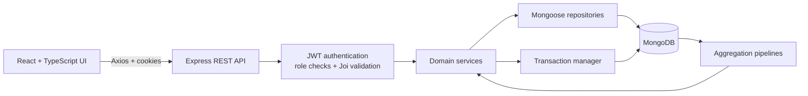

# Factory Management System

A full-stack operations platform for a factory, connecting production planning, warehouse execution, sales, returns, and management reporting in one workflow.

**Stack:** React, TypeScript, Vite, Tailwind CSS, Express, Node.js, MongoDB, Mongoose.

## What it does

| Area | Capabilities |
| --- | --- |
| Production | Plan batches, track planning and production stages, record output and loss, and receive finished goods into stock. |
| Inventory | Manage products and warehouse locations; track theoretical, reserved, sold, and physical quantities; execute picks and receipts by location and section. |
| Sales | Create shelf-stock and made-to-order line items, reserve available stock, finalize or cancel orders, and generate PDF invoices. |
| After-sales | Process returns, restore eligible stock, maintain customer history, and report operational issues. |
| Reporting | View executive, sales, production, inventory, and operations dashboards; export collections as CSV or Excel. |

The interface supports English and Arabic and shows navigation according to each user's role. The API enforces permissions for admin, sales, inventory, accounting, planning, and production roles.

## Architecture



The backend is organized by domain under [`backend/src/modules`](backend/src/modules): each module keeps its routes, request schemas, business logic, and persistence code together. Shared middleware handles authentication, authorization, validation, and errors. The frontend separates pages, reusable components, API services, and session state under [`frontend/src`](frontend/src).

### Engineering decisions

- **Stock follows the business event.** Shelf-stock order items reserve inventory at draft time; finalization moves reserved units to sold, while cancellation releases them. Made-to-order items do not reserve existing stock.
- **Physical work is explicit.** A stock movement can require a warehouse pick or receipt. Staff allocate quantities to locations and sections, and movements can be partially executed before completion. This keeps physical stock distinct from theoretical stock.
- **Related writes are transactional.** Orders, returns, batches, and warehouse executions use MongoDB sessions to update documents and stock movements together. Atomic counters assign order, return, and batch numbers.
- **Access is enforced at the API.** Passwords are hashed with bcrypt, JWTs are sent in HTTP-only cookies, and protected routes apply role checks and Joi request validation.
- **Reporting comes from operational data.** MongoDB aggregation pipelines calculate revenue, plan attainment, stock variance, movement activity, and issue metrics for five dashboards.

## Run locally

**Prerequisites:** Node.js 20.19+ and MongoDB configured as a replica set (or MongoDB Atlas). Multi-document transactions require a replica set.

1. Install dependencies and create local environment files:

   ```bash
   (cd backend && npm ci && cp .env.example .env)
   (cd frontend && npm ci && cp .env.example .env)
   ```

2. Set these values in `backend/.env`: `PORT=3000`, `MONGO_URI`, `JWT_SECRET`, `COOKIE_KEY`, `NODE_ENV=development`, and `CLIENT_URL=http://localhost:5173`. Set `VITE_API_URL=http://localhost:3000` in `frontend/.env`.

3. Start the API with `cd backend && npm run dev` and the UI in another terminal with `cd frontend && npm run dev`.

4. Open `http://localhost:5173`. The first admin must be provisioned directly in MongoDB with a bcrypt-hashed `password`, a `phoneNumber`, and `roles: ["admin"]`; user creation is admin-only and there is no public sign-up route.

API documentation is served at `http://localhost:3000/api-docs`. The OpenAPI document currently covers domain schemas and issue endpoints; other routes are defined in their respective module files.

## Deployment

[`render.yaml`](render.yaml) defines separate static frontend and Node API services for production, demo, and staging, with SPA rewrites and environment-specific configuration. Secrets and database URLs are supplied as deployment environment variables.
