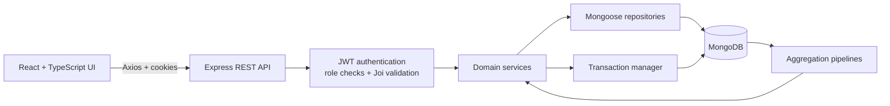

# Factory Management System

A full-stack operations platform for a factory, connecting production planning, warehouse execution, sales, returns, and management reporting in one workflow.

**Stack:** React, TypeScript, Vite, Tailwind CSS, Express, Node.js, MongoDB, Mongoose.

## What it does

| Area | Capabilities |
| --- | --- |
| Production | Plan batches, track planning and production stages, record output and loss, and receive finished goods into stock. |
| Inventory | Manage products and warehouse locations; track theoretical, reserved, sold, and physical quantities; execute picks and receipts by location and section. |
| Sales | Create shelf-stock and made-to-order line items, reserve available stock, finalize or cancel orders, and generate PDF invoices. |
| After-sales | Process returns, restore eligible stock, maintain customer history, and report operational issues. |
| Reporting | View executive, sales, production, inventory, and operations dashboards; export collections as CSV or Excel. |

The interface supports English and Arabic and shows navigation according to each user's role. The API enforces permissions for admin, sales, inventory, accounting, planning, and production roles.

## Code architecture



The backend is organized by domain in [`backend/src/modules`](backend/src/modules). Orders, batches, returns, products, and the other modules follow the same request path:

| Layer | Responsibility | Example |
| --- | --- | --- |
| App entry | Configure CORS, JSON and cookie parsing, authentication, API documentation, and route prefixes. | [`backend/src/app.js`](backend/src/app.js) |
| Routes | Declare endpoints and apply role checks and request validation. | [`order.routes.js`](backend/src/modules/orders/order.routes.js) |
| DTOs | Validate request bodies, params, and queries with Joi. | [`order.dtos.js`](backend/src/modules/orders/order.dtos.js) |
| Services | Enforce business rules, coordinate related writes, and return API responses. | [`order.service.js`](backend/src/modules/orders/order.service.js) |
| Repositories and models | Isolate Mongoose queries and define document schemas and indexes. | [`order.repository.js`](backend/src/modules/orders/order.repository.js), [`order.model.js`](backend/src/modules/orders/order.model.js) |
| Shared infrastructure | Run MongoDB transactions and handle authentication, authorization, errors, and document numbering. | [`transactionManager`](backend/src/database/transactionManager), [`middlewares`](backend/src/middlewares) |

For example, `POST /api/orders` passes through a route and Joi schema before the order service prices each item, creates the order, reserves shelf stock, and writes stock movements in a transaction. Repositories perform the database operations; the same movement records support warehouse execution and reporting.

The React frontend keeps navigation and page definitions in [`routes.tsx`](frontend/src/routes.tsx), backend calls in [`services`](frontend/src/services), session and notification state in [`contexts`](frontend/src/contexts), and English/Arabic resources in [`i18n`](frontend/src/i18n). Pages and reusable UI components live in their own directories under [`frontend/src`](frontend/src).

### Engineering decisions

- **Stock follows the business event.** Shelf-stock order items reserve inventory at draft time; finalization moves reserved units to sold, while cancellation releases them. Made-to-order items do not reserve existing stock.
- **Physical work is explicit.** A stock movement can require a warehouse pick or receipt. Staff allocate quantities to locations and sections, and movements can be partially executed before completion. This keeps physical stock distinct from theoretical stock.
- **Related writes are transactional.** Orders, returns, batches, and warehouse executions use MongoDB sessions to update documents and stock movements together. Atomic counters assign order, return, and batch numbers.
- **Access is enforced at the API.** Passwords are hashed with bcrypt, JWTs are sent in HTTP-only cookies, and protected routes apply role checks and Joi request validation.
- **Reporting comes from operational data.** MongoDB aggregation pipelines calculate revenue, plan attainment, stock variance, movement activity, and issue metrics for five dashboards.

## Run locally

**Prerequisites:** Node.js 20.19+ and MongoDB configured as a replica set (or MongoDB Atlas). Multi-document transactions require a replica set.

1. Install dependencies and create local environment files:

   ```bash
   (cd backend && npm ci && cp .env.example .env)
   (cd frontend && npm ci && cp .env.example .env)
   ```

2. Set these values in `backend/.env`: `PORT=3000`, `MONGO_URI`, `JWT_SECRET`, `COOKIE_KEY`, `NODE_ENV=development`, and `CLIENT_URL=http://localhost:5173`. Set `VITE_API_URL=http://localhost:3000` in `frontend/.env`.

3. Start the API with `cd backend && npm run dev` and the UI in another terminal with `cd frontend && npm run dev`.

4. Open `http://localhost:5173`. The first admin must be provisioned directly in MongoDB with a bcrypt-hashed `password`, a `phoneNumber`, and `roles: ["admin"]`; user creation is admin-only and there is no public sign-up route.

API documentation is served at `http://localhost:3000/api-docs`. The OpenAPI document currently covers domain schemas and issue endpoints; other routes are defined in their respective module files.

## Deployment

[`render.yaml`](render.yaml) describes separate frontend and API services on Render. Each service deploys automatically on commits to its configured branch:

| Environment | Branch | Services |
| --- | --- | --- |
| Production | `prod` | `prod-frontend`, `prod-backend` |
| Demo | `prod` | `demo-frontend`, `demo-backend` |
| Staging | `staging` | `staging-frontend`, `staging-backend` |

The frontend uses `frontend/` as its root, runs `npm install && npm run build`, and publishes `dist/` as a static site. A `/*` rewrite to `/index.html` supports client-side routes. The API uses `backend/` as its root, runs `npm install` and `npm start`, and connects to MongoDB through `MONGO_URI`. The configuration also includes an additional `zaid-*` service pair.

| Service | Environment variables |
| --- | --- |
| Frontend | `VITE_API_URL` (API origin), `VITE_IS_DEMO`; demo also accepts `VITE_DEMO_PHONE` and `VITE_DEMO_PIN` for its login notice. |
| API | `MONGO_URI`, `JWT_SECRET`, `COOKIE_KEY`, `CLIENT_URL` (frontend origin), `NODE_ENV`, `PORT`. |

Set `VITE_API_URL` and `CLIENT_URL` to the corresponding deployed service URLs. The API uses credentialed CORS and sends the JWT in an HTTP-only cookie; outside development, that cookie is marked `Secure` and `SameSite=None`, so the deployed frontend and API need HTTPS. Provide secrets and database credentials through Render environment variables.

**Storage note:** product uploads are served from the API's local `uploads/` directory. Persistent object storage is needed if uploaded images must survive service restarts or redeployments.
